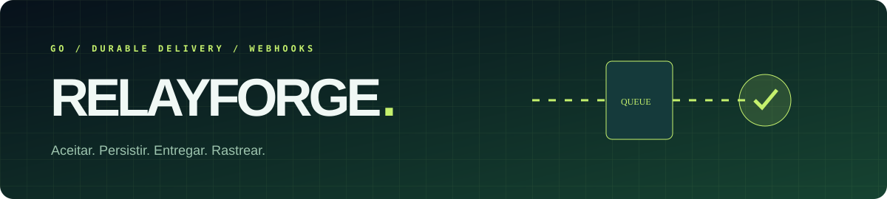

<p align="center"></p>

# RelayForge

Um despachante de webhooks em Go. A aplicação recebe um evento, devolve um ID imediatamente e tenta entregá-lo ao destino configurado. Se o destino estiver fora, registra a falha, espera e tenta de novo. O estado é reconstruído de um log append-only após reinício; repetir o mesmo ID não cria outra entrega.

O foco aqui não é só fazer um `POST`: é deixar visível o que foi aceito, quantas tentativas ocorreram e quais envios exigem investigação.

## Recursos

- `POST /api/jobs` autenticado por Bearer token, com validação de contrato e corpo limitado a 64 KiB.
- Fila single-writer persistida em NDJSON com `fsync`, replay no boot e deduplicação pelo ID do evento.
- Worker de entrega com timeout, retry exponencial e dead letter após quatro tentativas.
- Assinatura HMAC-SHA256 no payload enviado e `Idempotency-Key` repassado ao receptor.
- Destino definido apenas por ambiente — não pelo cliente da API — para evitar URL arbitrária. HTTPS obrigatório fora de localhost e redirects não são seguidos.
- Painel responsivo para acompanhar fila, entregues, falhas e histórico; animações com opção de movimento reduzido.
- Testes de replay, idempotência, assinatura, retry e API.

## Rodar localmente

Requer Go 1.27+. Não há dependências externas. Defina duas chaves distintas e um receptor HTTP local:

```bash
export RELAY_API_KEY='troque-por-uma-chave-aleatoria-com-24-caracteres'
export RELAY_SIGNING_KEY='use-outra-chave-aleatoria-com-24-caracteres'
export RELAY_DESTINATION='http://127.0.0.1:9090/webhooks'
go run .
```

No PowerShell, use `$env:RELAY_API_KEY='...'` e equivalentes. O painel abre em `http://127.0.0.1:8080`. Para testar uma entrega, inicie um receptor local e envie:

```bash
curl -X POST http://127.0.0.1:8080/api/jobs \
  -H "Authorization: Bearer $RELAY_API_KEY" \
  -H 'Content-Type: application/json' \
  -d '{"id":"evt-001","kind":"order.created","payload":{"order":42}}'
```

`202` significa enfileirado; repetição do ID retorna `200` com `duplicate: true`. `GET /api/jobs` mostra as transições; `GET /api/health` informa saúde básica. O receptor deve validar `X-Relay-Signature: sha256=<hex>` com a chave de assinatura. O `Idempotency-Key` permite que ele também trate reentrega sem efeito duplicado.

```bash
go test -race ./...
go vet ./...
```

## Operação e limites

```text
Produtor → autenticação → log durável → worker → HMAC → destino
                                  └── falha → retry → dead letter
```

O arquivo em `DATA_FILE` é propriedade de uma única instância. Monte um volume persistente e proteja tanto as chaves quanto o painel atrás de HTTPS/autenticação no proxy. O servidor escuta `127.0.0.1` por padrão. Para múltiplas instâncias, a etapa seguinte é trocar o log local por uma fila transacional e implementar lease por job; não execute dois workers apontando para o mesmo arquivo. O destino deve deduplicar por `Idempotency-Key`: uma queda após a entrega, mas antes da gravação do status, pode causar reenvio.

Para deploy, compile com `go build -o relayforge .`, configure as variáveis em secret manager, execute como serviço com diretório `data/` persistente e acompanhe logs e dead letters. Para rollback, reverta o binário/commit e preserve o volume: nenhum script de migração destrutiva é necessário. Faça backup do log antes de alterar seu formato em versões futuras.

---

<p align="center"><br><strong>Luis da Silva</strong><br>Back-end, integrações e operação confiável.</p>
